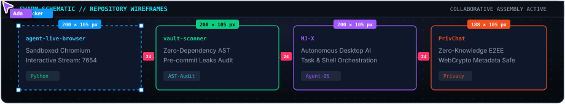
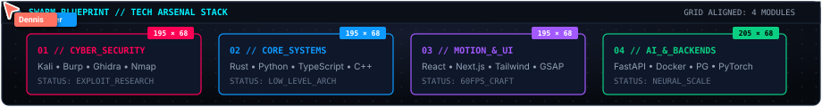
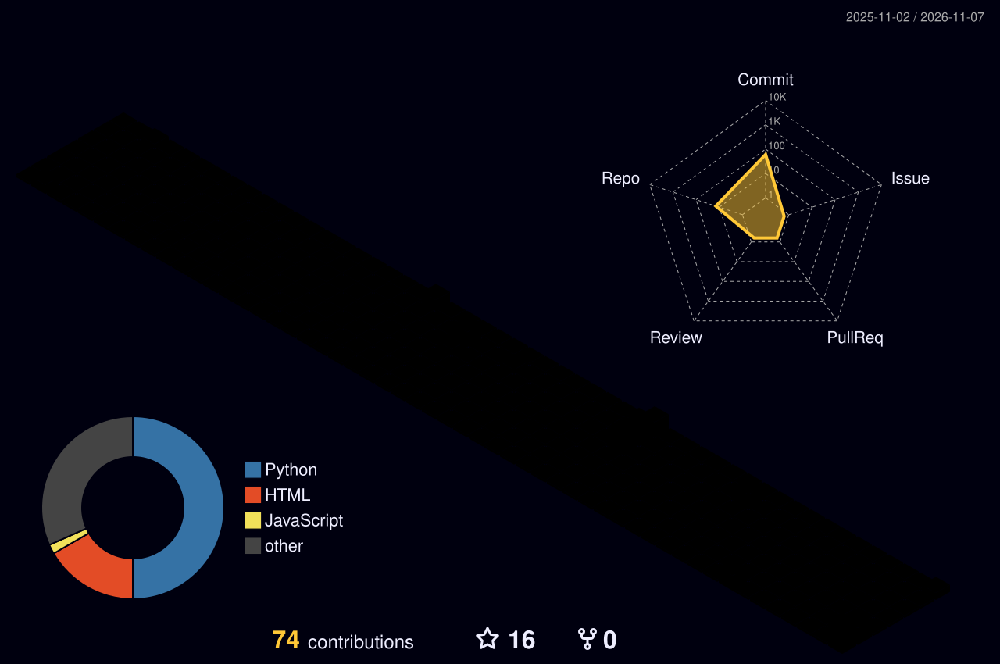

<div align="center">

<!-- ================================================================= -->
<!--               SWARM REBUILD // HERO CANVAS ASSEMBLY               -->
<!-- ================================================================= -->

<a href="https://sakshamgupta.online" target="_blank">
  
</a>

<br/>

<!-- Canvas Smart Guide Divider -->


<!-- Dynamic Typing Subtitle -->
<a href="https://sakshamgupta.online">
  
</a>

<br/>

<!-- Canvas Blueprint Badges -->
<p align="center">
  <a href="https://sakshamgupta.online" target="_blank">
    
  </a>
  &nbsp;
  
  &nbsp;
  
  &nbsp;
  
</p>

</div>

---

### 📐 [LAYER: 01 // IDENTITY &amp; SYSTEM SPECS]

```bash
$ madhacker --identity
[INFO] Name: Saksham Gupta (MADHacker912)
[INFO] Role: Full-Stack Systems Architect & Offensive Security Researcher
[INFO] Focus: Autonomous Browser Agents • AST Vulnerability Scanners • Chromium Daemons
[INFO] Motto: "Deconstruct to understand, rebuild to master."
```

- ⚡ **Autonomous Agents:** Engineering persistent sandboxed browser daemons and live-streamed agent harnesses (`agent-live-browser`).
- 🛡️ **Offensive Security:** AST-level secrets auditing (`vault-scanner`), wireless reconnaissance (`MJ-X`), and systems exploitation.
- 🚀 **Full-Stack Systems:** Production TypeScript & Python backends, real-time WebSocket pipelines, and high-FPS WebGL canvases.
- 🌐 **Canvas Portfolio:** [sakshamgupta.online](https://sakshamgupta.online)
- 📬 **Direct Inquiries:** [sakshamguptasg368@gmail.com](mailto:sakshamguptasg368@gmail.com)

---

## 🚀 [LAYER: 02 // FEATURED SCHEMATICS]

<!-- Swarm Interactive Schematic Board -->
<div align="center">
  
</div>

<br/>

### 🌐 [agent-live-browser](https://github.com/MADHacker912/agent-live-browser)
> Dedicated persistent sandboxed Chromium browser for AI agents with **real-time interactive live streaming at `http://localhost:7654`** and Google BotGuard stealth bypass.
>
> 
> 
> 
> 
> 

<br/>

### ⚡ [vault-scanner](https://github.com/MADHacker912/vault-scanner)
> Ultra-fast, zero-dependency, local secret and credential scanner. Performs deep AST analysis to catch leaked API keys, tokens, and sensitive data before git commits.
>
> 
> 
> 
> 

<br/>

### 🤖 [MJ-X](https://github.com/MADHacker912/MJ-X)
> Autonomous cross-platform AI assistant built for desktop task orchestration, terminal workflows, and natural language device operation.
>
> 
> 
> 
> 

<br/>

### ⚖️ [MJ-X-Law](https://github.com/MADHacker912/MJ-X-Law)
> Specialized legal intelligence engine for clause-by-clause commercial contract review, DPA analysis, risk scoring, and automated compliance triage.
>
> 
> 
> 
> 

<br/>

### 🔐 [PrivChat](https://github.com/MADHacker912/PrivChat)
> Privacy-first communication application with client-side end-to-end encryption, ephemeral channels, and zero-knowledge data persistence.
>
> 
> 
> 
> 

<br/>

### 📡 [WIFI-Flood](https://github.com/MADHacker912/WIFI-Flood)
> 802.11 wireless beacon frame security auditor and AP stress-testing utility for evaluating network resilience against frame-flooding attacks.
>
> 
> 
> 
> 

<br/>

<div align="center">
  
</div>

---

## 🛠️ [LAYER: 03 // TECHNICAL ARSENAL]

<!-- Swarm Tooling Canvas Board -->
<div align="center">
  
</div>

<br/>

<div align="center">

### 🛡️ CyberSecurity &amp; Reverse Engineering
<p align="center">
  
  
  
  
  
  
  
</p>

### ⚡ Core Systems &amp; Programming Languages
<p align="center">
  
  
  
  
  
  
  
  
</p>

### 🌐 Frontend Craft, Motion &amp; Mobile
<p align="center">
  
  
  
  
  
  
</p>

### 🧠 AI, Backends &amp; Infrastructure
<p align="center">
  
  
  
  
  
  
</p>

</div>

<br/>

<div align="center">
  
</div>

---

## 📈 [LAYER: 04 // REBUILD TELEMETRY]

### 🎮 Contribution Snake
<div align="center">
  <picture>
    <source media="(prefers-color-scheme: dark)" srcset="https://raw.githubusercontent.com/MADHacker912/MADHacker912/output/github-contribution-grid-snake-dark.svg">
    <source media="(prefers-color-scheme: light)" srcset="https://raw.githubusercontent.com/MADHacker912/MADHacker912/output/github-contribution-grid-snake.svg">
    
  </picture>
</div>

<br/>

### 🧊 3D Isometric Timeline
<div align="center">
  <picture>
    <source media="(prefers-color-scheme: dark)" srcset="https://raw.githubusercontent.com/MADHacker912/MADHacker912/main/profile-3d-contrib/profile-night-rainbow.svg">
    <source media="(prefers-color-scheme: light)" srcset="https://raw.githubusercontent.com/MADHacker912/MADHacker912/main/profile-3d-contrib/profile-gitblock.svg">
    
  </picture>
</div>

<br/>

<div align="center">
  
</div>

---

## 🌐 [LAYER: 05 // MULTIPLAYER UPLINK]

<div align="center">
  <p><i>Always open to collaborating on ambitious open-source tools, cybersecurity research, and AI systems.</i></p>

  <a href="https://sakshamgupta.online" target="_blank">
    
  </a>
  &nbsp;
  <a href="https://www.linkedin.com/in/saksham-gupta-9125obito" target="_blank">
    
  </a>
  &nbsp;
  <a href="https://twitter.com/saksham_gupta" target="_blank">
    
  </a>
  &nbsp;
  <a href="https://discord.gg/_obito_gupta_" target="_blank">
    
  </a>
  &nbsp;
  <a href="https://instagram.com/_vibecoder" target="_blank">
    
  </a>
  &nbsp;
  <a href="https://kaggle.com/saksham_gupta" target="_blank">
    
  </a>
  &nbsp;
  <a href="mailto:sakshamguptasg368@gmail.com">
    
  </a>
</div>

<br/>

<!-- ================================================================= -->
<!--                    SWARM REBUILD // "GO LIVE" ACTION              -->
<!-- ================================================================= -->

<div align="center">
  
</div>
