<!-- ═══════════════════════════════════════════════════════════════ -->
<!--                  CYBERPUNK ANIMATED HERO BANNER                 -->
<!-- ═══════════════════════════════════════════════════════════════ -->

<!-- Animated Cyber Divider -->

<!-- ═══════════════════════════════════════════════════════════════ -->
<!--                  DYNAMIC ROTATING TYPING MOTION                -->
<!-- ═══════════════════════════════════════════════════════════════ -->

 

<!-- Real-time HUD Status & Badges -->

  
  
  
  

<!-- ═══════════════════════════════════════════════════════════════ -->
<!--                 ANIMATED CYBER MAINFRAME HUD                   -->
<!-- ═══════════════════════════════════════════════════════════════ -->

  

 

  

<!-- ═══════════════════════════════════════════════════════════════ -->
<!--                  FLAGSHIP ENGINEERED PROJECTS                  -->
<!-- ═══════════════════════════════════════════════════════════════ -->

<h2 align="center">
  
   <b>FEATURED HIGH-IMPACT ARSENAL</b> 
  
</h2>

  
<i>Autonomous AI agents, zero-dependency security engines, and cutting-edge software systems.</i>

  <table border="0">
    <tr>
      <td>
        
      </td>
      <td>
        
      </td>
    </tr>
    <tr>
      <td>
        
      </td>
      <td>
        
      </td>
    </tr>
  </table>

 

  

<!-- ═══════════════════════════════════════════════════════════════ -->
<!--                     TECH ARSENAL & WEAPONRY                    -->
<!-- ═══════════════════════════════════════════════════════════════ -->

<h2 align="center">
  
   <b>CORE WEAPONS &amp; TECH STACK</b> 
  
</h2>

### 🛡️ CyberSecurity, Reverse Engineering &amp; Exploitation

  
  
  
  
  
  
  
  

### ⚡ Core Systems &amp; Programming Languages

  
  
  
  
  
  
  
  

### 🌐 Frontend Craft, Motion &amp; Mobile

  
  
  
  
  
  
  
  

### 🧠 AI, Autonomous Systems &amp; Backend Infrastructure

  
  
  
  
  
  
  
  

 

  

<!-- ═══════════════════════════════════════════════════════════════ -->
<!--                  GITHUB TELEMETRY & METRICS                    -->
<!-- ═══════════════════════════════════════════════════════════════ -->

<h2 align="center">
  
   <b>NEURAL ACTIVITY &amp; TELEMETRY</b> 
  
</h2>

  <table border="0">
    <tr>
      <td>
        
      </td>
      <td>
        
      </td>
    </tr>
    <tr>
      <td colspan="2" align="center">
        
      </td>
    </tr>
  </table>

 

  

<!-- ═══════════════════════════════════════════════════════════════ -->
<!--              CONTRIBUTION MATRIX // SNAKE GAME                 -->
<!-- ═══════════════════════════════════════════════════════════════ -->

<h2 align="center">
  
   <b>CONTRIBUTION GRID // SNAKE EATER</b> 
  
</h2>

  
<i>Automated cyber snake devouring contributions across the GitHub timeline.</i>

  <picture>
    <source media="(prefers-color-scheme: dark)" srcset="https://raw.githubusercontent.com/MADHacker912/MADHacker912/output/github-contribution-grid-snake-dark.svg">
    <source media="(prefers-color-scheme: light)" srcset="https://raw.githubusercontent.com/MADHacker912/MADHacker912/output/github-contribution-grid-snake.svg">
    
  </picture>

 

  

<!-- ═══════════════════════════════════════════════════════════════ -->
<!--                     NEURAL UPLINK / SOCIALS                    -->
<!-- ═══════════════════════════════════════════════════════════════ -->

<h2 align="center">
  
   <b>ESTABLISH UPLINK // CONNECT</b> 
  
</h2>

  
<i>Looking for collaboration, visionary engineering, or security research? Drop a ping.</i>

  
  &nbsp;
  
  &nbsp;
  
  &nbsp;
  
  &nbsp;
  
  &nbsp;
  
  &nbsp;
  

 

<!-- ═══════════════════════════════════════════════════════════════ -->
<!--                        ANIMATED FOOTER                         -->
<!-- ═══════════════════════════════════════════════════════════════ -->

  
  
  

    <i>⚡ "Vibe Coder" — Learning by Deconstructing, Mastering by Building. ⚡</i>
  

